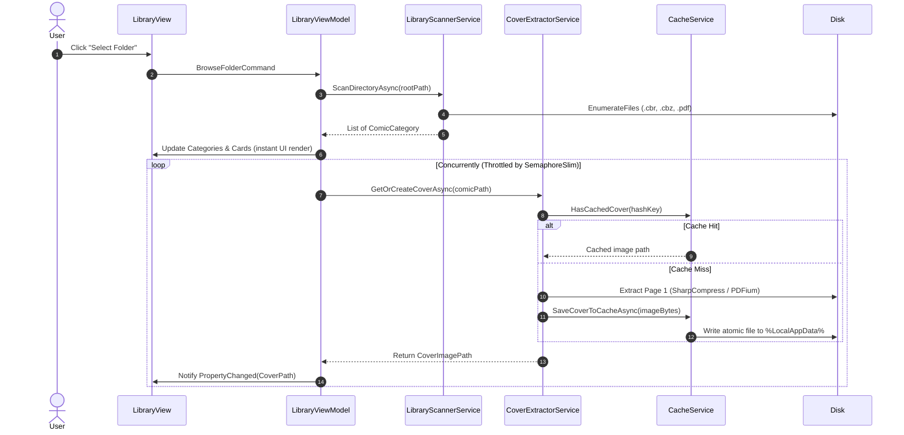
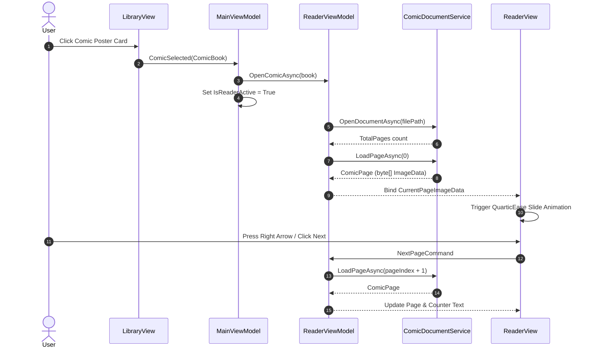

# ComicFlix - Local-First Digital Comic & PDF Reader

ComicFlix is a high-performance, local-first, offline Windows desktop application built with **C# / WPF (.NET 8)** adhering strictly to the **MVVM (Model-View-ViewModel)** architectural pattern. It delivers a **Netflix-style library browsing interface** with horizontal category shelves mapped from subfolders, dynamic first-page cover extraction with SHA-256 disk caching, and a smooth, full-screen comic reading experience with page slide animations.

---

## Table of Contents
1. [Architectural Overview](#architectural-overview)
2. [Directory Structure](#directory-structure)
3. [Deep Dive into Code Components](#deep-dive-into-code-components)
   - [Configuration Layer](#1-configuration-layer)
   - [Domain Models](#2-domain-models)
   - [Services (The Core Engine)](#3-services-the-core-engine)
   - [ViewModels (Presentation Logic)](#4-viewmodels-presentation-logic)
   - [Views (The Netflix UI)](#5-views-the-netflix-ui)
   - [Value Converters & Utilities](#6-value-converters--utilities)
   - [Application Shell & Dependency Injection](#7-application-shell--dependency-injection)
4. [Data & Execution Flows](#data--execution-flows)
   - [Directory Scanning & Cover Generation Flow](#directory-scanning--cover-generation-flow)
   - [Comic Reading & Navigation Flow](#comic-reading--navigation-flow)
5. [Keyboard & Mouse Shortcuts](#keyboard--mouse-shortcuts)
6. [Building and Running](#building-and-running)

---

## Architectural Overview

The application is structured according to clean architecture and separation of concerns:

- **Config-Driven & Persistent**: Hardcodes zero business rules, UI colors, cache paths, or extensions. The user's selected library directory is permanently saved and reloaded automatically on future startups.
- **First-Time Startup Onboarding**: On first launch, guides the user with a setup screen to choose their comic root folder. Once selected, it is remembered forever.
- **Local-First & Completely Offline**: No network dependencies at runtime. Operates purely against the local filesystem.
- **Strict MVVM Pattern**: Views contain zero business logic. ViewModels expose reactive state and commands using `CommunityToolkit.Mvvm`.
- **Thread Safety & UI Fluidity**: Heavy operations (directory recursion, archive decompression, PDFium rasterization, thumbnail downscaling) execute on background threads via `Task.Run` with `SemaphoreSlim` concurrency throttling.
- **Natural Alphanumeric Sorting**: Uses Windows native `StrCmpLogicalW` so filenames sort naturally (`Issue 1`, `Issue 2`, `Issue 10`).

```
┌─────────────────────────────────────────────────────────────┐
│                         Views (XAML)                        │
│   MainWindow.xaml   │   LibraryView.xaml   │   ReaderView   │
└──────────────────────────────┬──────────────────────────────┘
                               │ Data Binding & Commands
┌──────────────────────────────▼──────────────────────────────┐
│                      ViewModels (MVVM)                      │
│   MainViewModel     │   LibraryViewModel   │ ReaderViewModel│
│   ComicCategoryViewModel                   │ ComicCardVM    │
└──────────────────────────────┬──────────────────────────────┘
                               │ Injected Interfaces
┌──────────────────────────────▼──────────────────────────────┐
│                    Services (Core Engine)                   │
│   LibraryScannerService │ CoverExtractorService │ CacheSvc  │
│   ComicDocumentService  │ ConfigurationService  │           │
└──────────────────────────────┬──────────────────────────────┘
                               │ Decompression & Rasterization
┌──────────────────────────────▼──────────────────────────────┐
│               Native / Third-Party Engines                  │
│       SharpCompress (CBR/CBZ)   │   Docnet.Core (PDFium)    │
└─────────────────────────────────────────────────────────────┘
```

---

## Directory Structure

```
ComicReader/
├── comic_reader.csproj                     # .NET 8 Windows Desktop project file
├── appsettings.json                        # Central configuration file
├── App.xaml                                # Application styles, brushes & converters
├── App.xaml.cs                             # Composition root & ServiceProvider setup
├── README.md                               # Codebase documentation (this file)
├── REQUIREMENTS.md                         # Detailed functional/system specifications
│
├── Config/                                 # Strongly-typed configuration objects
│   ├── AppSettings.cs                      # Root settings aggregator
│   ├── LibrarySettings.cs                  # File extensions, parallelism, thumbnail bounds
│   ├── CacheSettings.cs                    # Cache directory and storage limits
│   ├── ReaderSettings.cs                   # Animation durations and default fit modes
│   └── ThemeSettings.cs                    # Netflix dark theme palette
│
├── Models/                                 # Pure domain entities
│   ├── ComicBook.cs                        # Comic metadata (title, path, size, cover)
│   ├── ComicCategory.cs                    # Folder category grouping books
│   ├── ComicPage.cs                        # Decoded page bitmap & dimensions
│   └── PageFitMode.cs                      # Enum: FitToScreen, FitToWidth, FitToHeight, Original
│
├── Services/                               # Business logic & I/O engine
│   ├── Interfaces/
│   │   ├── IConfigurationService.cs        # Config provider contract
│   │   ├── ICacheService.cs                # Deterministic disk cache contract
│   │   ├── ICoverExtractorService.cs       # Cover extraction contract (.cbr, .cbz, .pdf)
│   │   ├── IComicDocumentService.cs        # Multi-page document navigation contract
│   │   └── ILibraryScannerService.cs       # Directory recursion contract
│   ├── ConfigurationService.cs             # Reads appsettings.json via Microsoft.Extensions
│   ├── CacheService.cs                     # SHA-256 metadata-keyed disk cache
│   ├── CoverExtractorService.cs            # SharpCompress & PDFium cover extractor
│   ├── ComicDocumentService.cs             # Thread-safe multi-page document loader
│   └── LibraryScannerService.cs            # Subfolder hierarchy mapper
│
├── ViewModels/                             # CommunityToolkit.Mvvm presentation logic
│   ├── BaseViewModel.cs                    # (ObservableObject base)
│   ├── ComicCardViewModel.cs               # Individual comic poster card state
│   ├── ComicCategoryViewModel.cs           # Shelf row ViewModel
│   ├── LibraryViewModel.cs                 # Catalog browsing, scanning & search
│   ├── ReaderViewModel.cs                  # Fullscreen reader, zoom, fit & navigation
│   └── MainViewModel.cs                    # Shell navigation coordinator
│
├── Views/                                  # WPF XAML presentation layer
│   ├── MainWindow.xaml                     # Shell window hosting Library and Reader
│   ├── MainWindow.xaml.cs                  # Shell code-behind
│   ├── LibraryView.xaml                    # Netflix-style shelf browser
│   ├── LibraryView.xaml.cs                 # LibraryView code-behind
│   ├── ReaderView.xaml                     # Fullscreen comic viewer with slide animations
│   └── ReaderView.xaml.cs                  # Keyboard navigation & animation code-behind
│
├── Converters/                             # Value converters for XAML bindings
│   ├── ByteArrayToBitmapConverter.cs       # Converts byte[] image to frozen BitmapImage
│   ├── FitModeToBooleanConverter.cs        # Maps PageFitMode enum to RadioButton IsChecked
│   ├── InverseBooleanToVisibilityConverter.cs # Inverts bool to Visibility
│   └── NullToVisibilityConverter.cs        # Maps null/empty to Visibility
│
└── Utilities/
    └── NaturalStringComparer.cs            # P/Invoke StrCmpLogicalW natural sorting
```

---

## Deep Dive into Code Components

### 1. Configuration Layer

#### `appsettings.json`
Acts as the single source of truth for runtime configuration:
- `Library.SupportedExtensions`: Configurable array (`[".cbr", ".cbz", ".pdf"]`).
- `Library.MaxDegreeOfParallelism`: Concurrency cap for background thumbnail extraction.
- `Library.ThumbnailMaxWidth` & `ThumbnailMaxHeight`: 360x540 bounding box (maintaining a 2:3 poster aspect ratio).
- `Cache.CacheDirectory`: Resolves environment variables (`%LocalAppData%\ComicReader\Cache\Covers`).
- `Reader.PageAnimationDurationMs`: Duration (250ms) for page slide animations.
- `Theme`: Hex codes for the Netflix dark palette (`#141414` primary, `#E50914` Netflix red accent).

#### `Config/AppSettings.cs` & Subclasses
Plain C# classes bound by `ConfigurationService` using `Microsoft.Extensions.Configuration.Binder`.

---

### 2. Domain Models

- **`ComicBook`**: Represents a file on disk. Holds `Title`, `FilePath`, `FileSizeBytes`, `LastModifiedUtc`, `CategoryName`, `RelativeSubfolder`, and `CoverCachePath`.
- **`ComicCategory`**: Represents a shelf/row. Contains a `Name` (e.g., `"Marvel / Spider-Man"`), `RelativePath`, and an `ObservableCollection<ComicBook>`.
- **`ComicPage`**: Represents an individual decoded comic page. Holds `PageIndex`, `PageNumber`, `ImageData` (`byte[]`), `PixelWidth`, and `PixelHeight`.
- **`PageFitMode`**: Enum defining sizing behavior:
  - `FitToScreen`: Uniform scale within current viewport.
  - `FitToWidth`: Scales to viewport width, enabling vertical scrolling for tall pages or webtoons.
  - `FitToHeight`: Scales to viewport height.
  - `OriginalSize`: 1:1 pixel rendering with dual scrollbars.

---

### 3. Services (The Core Engine)

#### `CacheService.cs` (`ICacheService`)
- **Key Generation**: Uses `SHA256.HashData` over `${filePath.ToUpper()}|${lastModifiedTicks}|${fileLength}`. This guarantees that:
  1. The key is deterministic and safe for Windows filenames.
  2. If the user updates or replaces a comic file, the hash changes automatically and re-extracts the cover.
- **Atomic Disk Writes**: Writes new covers to `.tmp` files first, then performs `File.Move(temp, target, overwrite: true)` to prevent corrupted or half-written thumbnail files.

#### `CoverExtractorService.cs` (`ICoverExtractorService`)
Dynamically creates poster thumbnails for the Netflix view:
- **For Archives (`.cbr`, `.cbz`)**:
  - Uses `SharpCompress.Archives.ArchiveFactory.Open(filePath)`.
  - Filters non-directory entries matching image extensions (`.jpg`, `.jpeg`, `.png`, `.webp`, `.bmp`).
  - Sorts entry keys naturally via `NaturalStringComparer.Instance`.
  - Extracts the first entry stream into memory.
- **For PDFs (`.pdf`)**:
  - Uses `DocLib.Instance.GetDocReader(filePath, new PageDimensions(width, height))`.
  - Reads page 0 via `GetPageReader(0)`.
  - Retrieves raw BGRA pixels and constructs a `BitmapSource.Create(..., PixelFormats.Bgra32, ...)`.
  - Encodes the rasterized page to JPEG via `JpegBitmapEncoder`.
- **Thumbnail Optimization**: If the source cover image exceeds 360x540, scales it down proportionally via WPF `TransformedBitmap` to conserve memory and disk cache space.

#### `ComicDocumentService.cs` (`IComicDocumentService`)
Manages open multi-page archives or PDF documents:
- Thread-safe access via `SemaphoreSlim(1, 1)`.
- `OpenDocumentAsync(filePath)`: Detects whether the file is a PDF or archive, opens the reader instance, indexes all page entries, and returns total page count.
- `LoadPageAsync(pageIndex)`: Reads the specific page entry on demand, avoiding decoding the entire book into memory.
- `CloseDocument()`: Cleanly disposes native PDFium handles and archive streams.

#### `LibraryScannerService.cs` (`ILibraryScannerService`)
- Recursively traverses the root folder with `DirectoryInfo.EnumerateFiles("*.*", SearchOption.AllDirectories)`.
- Filters files against `SupportedExtensions`.
- Calculates relative subfolder paths using `Path.GetRelativePath(rootDirectory, file.DirectoryName)`.
- Root files are assigned to the primary root category.
- Subfolder files are assigned to breadcrumb categories (e.g. `DC Comics / Batman / Year One`).
- Sorts categories and files with natural ordering.

---

### 4. ViewModels (Presentation Logic)

#### `ComicCardViewModel.cs`
- Wraps an individual `ComicBook`.
- Exposes `Title`, `CoverPath`, `ExtensionBadge` (`CBR`, `PDF`), and `FileSizeFormatted`.
- `LoadCoverAsync`: Asynchronously calls `CoverExtractorService.GetOrCreateCoverAsync` and assigns `CoverPath`.

#### `LibraryViewModel.cs`
- Drives the library browser.
- Commands: `BrowseFolderCommand` (launches `OpenFolderDialog`), `RefreshCommand`, `OpenComicCommand`.
- **Concurrency Throttling**: After discovering comics, queues cover extraction across a `SemaphoreSlim` initialized with `MaxDegreeOfParallelism` (default: 4). This prevents disk thrashing and keeps the UI at 60 FPS while covers populate asynchronously.

#### `ReaderViewModel.cs`
- Controls the full-screen reader.
- Exposes `CurrentPageImageData`, `CurrentPageIndex`, `TotalPages`, `FitMode`, and `ZoomFactor`.
- Commands: `NextPageCommand`, `PreviousPageCommand`, `GoToPageCommand`, `SetFitModeCommand`, `ZoomInCommand`, `ZoomOutCommand`, `ResetZoomCommand`, `CloseReaderCommand`.
- Dispatches `CloseRequested` event back to `MainViewModel`.

#### `MainViewModel.cs`
- Coordinates navigation state between `LibraryViewModel` and `ReaderViewModel`.
- When a comic is selected in `LibraryViewModel`, activates `IsReaderActive = true` and opens the comic in `ReaderViewModel`.
- When reader closes, switches back to `IsReaderActive = false`.

---

### 5. Views (The Netflix UI)

#### Theme Palette & Styling (`App.xaml`)
- Dark charcoal canvas (`#141414`).
- Elevated card surface (`#232323`).
- Netflix red accent (`#E50914`, hover `#F40612`).
- Ultra-thin custom dark scrollbars (`MinimalistThumb`) with red drag highlight.

#### Library View (`Views/LibraryView.xaml`)
- **Top Navigation Bar**: Brand logo, active directory path, and folder selector.
- **Category Shelves**: Nested `ItemsControl` displaying category headers with count badges, and horizontally scrolling rows of 2:3 comic cards (`170x255`).
- **Interactive Poster Cards**:
  - Image element with `RenderOptions.BitmapScalingMode="HighQuality"`.
  - Format badge (`CBR` / `PDF`) in top right.
  - Dark gradient overlay on bottom with two-line title truncation and file size.
  - Hover trigger: 2px Netflix red border and elevated background.

#### Reader View (`Views/ReaderView.xaml` & `.xaml.cs`)
- **Pitch Black Canvas (`#0A0A0A`)**: Full immersion with centered page host.
- **Smooth Page Slide Animation**: In `ReaderView.xaml.cs`, whenever `CurrentPageIndex` changes, triggers a `DoubleAnimation` on `TranslateTransform.X` with `QuarticEase`:
  - Forward: Slides in smoothly from +60px to 0.
  - Backward: Slides in smoothly from -60px to 0.
- **Clickable Edge Zones**: Semi-transparent hover chevrons on the left 120px (Previous) and right 120px (Next) of the screen.
- **Floating Controls**: Auto-hiding semi-transparent pill bars for header navigation (Fit mode toggles, Zoom +/-) and bottom page scrubbing (Slider, page count badge).

---

### 6. Value Converters & Utilities

- **`ByteArrayToBitmapConverter`**: Decodes `byte[]` to a frozen `BitmapImage` with `BitmapCacheOption.OnLoad` so background memory streams can be garbage-collected immediately.
- **`FitModeToBooleanConverter`**: Two-way converter binding `PageFitMode` enum values to XAML `RadioButton.IsChecked`.
- **`NaturalStringComparer`**: P/Invokes Windows `shlwapi.dll!StrCmpLogicalW`. Sorts entries like `1.jpg`, `2.jpg`, `10.jpg` instead of alphabetical `1.jpg`, `10.jpg`, `2.jpg`.

---

### 7. Application Shell & Dependency Injection

#### `App.xaml.cs`
Configures Microsoft Dependency Injection container:
```csharp
private static void ConfigureServices(IServiceCollection services)
{
    // Services
    services.AddSingleton<IConfigurationService, ConfigurationService>();
    services.AddSingleton<ICacheService, CacheService>();
    services.AddSingleton<ICoverExtractorService, CoverExtractorService>();
    services.AddTransient<IComicDocumentService, ComicDocumentService>();
    services.AddSingleton<ILibraryScannerService, LibraryScannerService>();

    // ViewModels
    services.AddSingleton<LibraryViewModel>();
    services.AddSingleton<ReaderViewModel>();
    services.AddSingleton<MainViewModel>();

    // Views
    services.AddTransient<MainWindow>();
}
```

---

## Data & Execution Flows

### Directory Scanning & Cover Generation Flow



### Comic Reading & Navigation Flow



---

## Keyboard & Mouse Shortcuts

| Key / Input | Action |
| :--- | :--- |
| `Right Arrow` / `Space` / `Page Down` | Next Page |
| `Left Arrow` / `Shift + Space` / `Page Up` / `Backspace` | Previous Page |
| `Home` | First Page |
| `End` | Last Page |
| `Escape` | Exit Reader (Return to Netflix Library) |
| `H` | Toggle Floating Controls Overlay |
| `Left Screen Click` | Previous Page |
| `Right Screen Click` | Next Page |

---

## Building and Running

### Prerequisites
- Windows 10 (Build 19041+) or Windows 11 (64-bit)
- [.NET 8.0 SDK](https://dotnet.microsoft.com/download/dotnet/8.0)

### Restore & Build
```powershell
# Restore NuGet dependencies
dotnet restore

# Build solution in Debug configuration
dotnet build
```

### Run Application
```powershell
dotnet run
```

